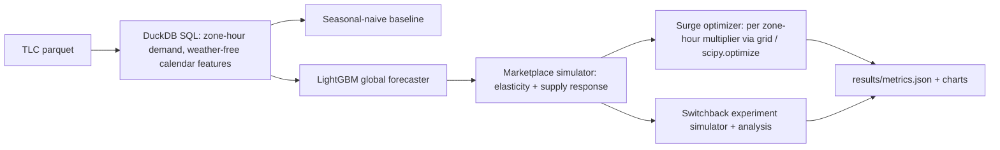

# Ride-hail demand forecasting, surge pricing, and switchback experiments

Yellow-taxi pickups from January through March 2024 are used to forecast April demand by taxi zone and hour. Those forecasts feed a marketplace simulator: riders respond to the surge multiplier, drivers respond in the other direction, and completed trips are the smaller of the two. A grid search picks a multiplier for each zone-hour without raising the average rider price above flat pricing. Simulated switchback experiments, randomized in time blocks and analyzed with clustered standard errors, are checked against the known effect of a citywide price change. A user-level A/B split of the same market shares driver supply, so its contrast is biased.

## Setup

```text
python -m venv .venv
.venv\Scripts\pip install -r requirements.txt
```

Python 3.11 or 3.12. No paid APIs and no GPU.

## How to run

From this folder:

```text
python run.py
```

That downloads the four TLC parquet files into `data/` (cached on later runs), trains the forecaster, writes `results/`, and refreshes the results table below plus `RESUME_NOTES.md`.

```text
python run.py --quick
```

`--quick` skips the download and runs the same code on a small synthetic trip file. It is the path the tests use, and it finishes in a few minutes. Optional flags: `--output-dir`, `--cache-dir`, and `--device cpu` (the default). `--device cuda` is accepted and ignored; training stays on CPU.

Tests:

```text
python -m pytest --cov=src --cov-report=term-missing
```

The coverage criterion is at least 70% of `src/`.

## Architecture



## Design decisions

The forecast is one step ahead. For hour t the features are lags and a trailing mean built only from hours before t, plus calendar fields known in advance. That matches an hourly pricing job, where last hour's trips are already in. It is not a 30-day-ahead forecast from the end of March.

April is held out. Trees stop on 18-31 March validation loss. The top 50 zones are the busiest zones in the training window only. Hyperparameters in `src/ride_pricing/config.py` are fixed before the test month is scored.

The seasonal-naive baseline is the same zone and hour one week earlier (`lag_168`). LightGBM sees that lag along with shorter lags, so it can stay close to the baseline and correct it when the recent level disagrees with last week. The loss is absolute error, which lines up with WAPE.

TLC files do not record idle drivers or unmet requests, and they are not a randomized price test. Rider elasticity is set to -0.5, in the neighborhood of the UberX elasticities in Cohen, Hahn, Hall, Levitt, and Metcalfe (2016). Driver supply elasticity is set to 1.0, a moderate positive labor-supply response of the kind discussed by Chen, Chevalier, Rossi, and Oehlsen (2019). Commute hours (7-9 and 16-19) are given a driver shortage (supply ratio 0.62). Other hours are given slack (supply ratio 1.55). Those ratios are assumptions, not a fit to April outcomes.

The optimizer scores a multiplier grid in each zone-hour and uses `scipy.optimize` to pick a penalty on high prices. Flat pricing (multiplier 1) is always a feasible candidate, so the search is not allowed to cut completed trips or to raise the demand-weighted average fare.

The switchback design assigns treatment to whole time blocks. Every unit in a block shares the assignment. The estimator is ordinary least squares with cluster-robust standard errors at the block, repeated for 500 experiments. The true effect is the average zone-hour change in completed trips from moving the whole market from multiplier 1 to 0.85, computed from the simulator. The naive comparison randomizes riders inside the zone-hour instead, so treated and control riders share one driver pool.

## Results

<!-- RESULTS_START -->

| Criterion | Value | Threshold | Passed |
|---|---:|---:|:---:|
| April zone-hour demand WAPE (top 50 zones) | 0.146127 | <= 0.250000 | yes |
| April zone-hour demand WAPE (top 50 zones) improvement vs seasonal-naive | 0.242733 | >= 0.150000 | yes |
| Completed trips under optimized surge vs. flat pricing | 0.213094 | >= 0.050000 | yes |
| Average rider price under optimized surge vs flat pricing | 18.755521 | <= 20.000000 | yes |
| Switchback analysis 95% CI coverage of the true effect | 0.942000 | >= 0.920000 | yes |
| Switchback bias vs one third of naive user-level A/B bias | 0.011451 | < 1.598972 | yes |

| Metric | Value |
|---|---:|
| April top-zone WAPE, LightGBM | 0.146127 |
| April top-zone WAPE, seasonal naive | 0.192966 |
| March validation WAPE, LightGBM | 0.147447 |
| March validation WAPE, seasonal naive | 0.185280 |
| WAPE improvement vs naive | 0.242733 |
| Simulated trips, optimized | 3510636.0811 |
| Simulated trips, flat | 2893951.8293 |
| Trip lift | 0.213094 |
| Avg rider price, optimized | 18.755521 |
| Avg rider price, flat | 20.000000 |
| Switchback 95% CI coverage | 0.942000 |
| Switchback absolute bias | 0.011451 |
| Naive user-level absolute bias | 4.796915 |
| Bias ratio (switchback / naive) | 0.002387 |
| Runtime seconds | 5.15 |
| Peak RSS GiB | 0.4308 |

Values are fractions (0.25 means 25%), except prices in USD, trip totals, seconds, and GiB.
This table is written by `python run.py` from `results/metrics.json`.

<!-- RESULTS_END -->

Plots written next to the metrics file:

- `results/wape_comparison.png`
- `results/forecast_example_zone.png`
- `results/surge_multiplier_hist.png`
- `results/switchback_estimates.png`

## Evaluation artifacts

Metrics in `results/metrics.json` are computed from these CSVs. Recompute them with the formulas below. `row_id` is `zone_id|timestamp` for trip rows and `experiment_id` is the id for a simulated experiment.

| File | Role |
|---|---|
| `results/forecast_test_predictions.csv` | April top-zone actuals, LightGBM, and seasonal naive |
| `results/top50_zones.csv` | Training-period zone ranking |
| `results/surge_zone_hour.csv` | Multiplier, completed trips, and rider price versus flat |
| `results/switchback_experiments.csv` | One row per experiment: estimate, 95% CI, true effect |
| `results/naive_ab_cells.csv` | User-level contrast and citywide effect by zone-hour |

- WAPE = sum(abs(actual - prediction)) / sum(abs(actual))
- Improvement = (WAPE naive - WAPE LightGBM) / WAPE naive
- Trip lift = sum(completed_optimized) / sum(completed_flat) - 1
- Average rider price = sum(completed * rider_price) / sum(completed)
- CI coverage = share of experiments with ci_low <= true_effect <= ci_high
- Switchback bias = abs(mean(estimate) - true_effect)
- Naive bias = abs(mean(naive_estimate) - mean(true_effect))

## Dataset

NYC TLC Yellow Taxi Trip Records, January through April 2024, from the [TLC trip record data page](https://www.nyc.gov/site/tlc/about/tlc-trip-record-data.page).

License: NYC Open Data. These yellow-taxi trip records are public city data published by the NYC Taxi and Limousine Commission. The trip-record page does not name a separate software license, a fee, or a restriction on reuse. `python run.py` downloads the parquet files from the TLC CloudFront bucket, caches them under `data/`, and checks a SHA-256 and a row count stored in `src/ride_pricing/config.py`.

## Limitations

Yellow taxis are a public stand-in for ride-hail, not Uber or Lyft trips. Elasticities and the peak/off-peak supply ratios are assumptions, so the trip lift is a property of the simulator, not a measured launch result. The supply ratio depends on hour of day only, so a busy Saturday night is treated like any other late hour. The forecaster does not use weather, events, or neighboring zones. Switchback coverage is a Monte Carlo check of the analysis under a block-shock model, not a record of a live experiment. Peak memory is meant to stay under 3 GB; DuckDB is capped at 1.5 GB and LightGBM uses 4 threads.

Test coverage of `src/` is measured with `pytest-cov`, not by `python run.py`. The latest run of that command covered 89% of statements in `src/`.
